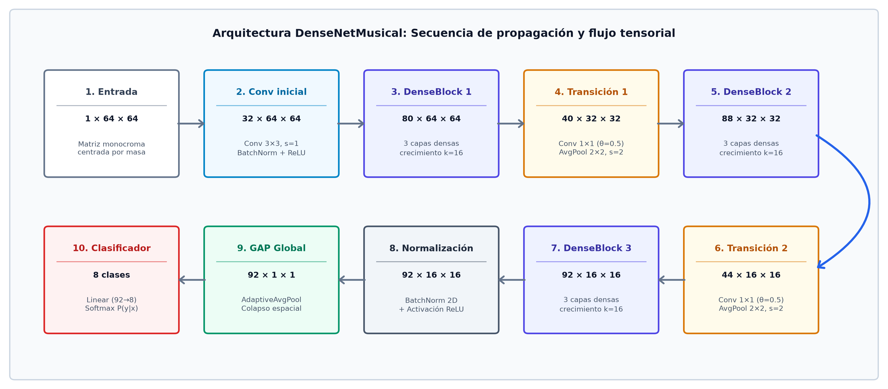
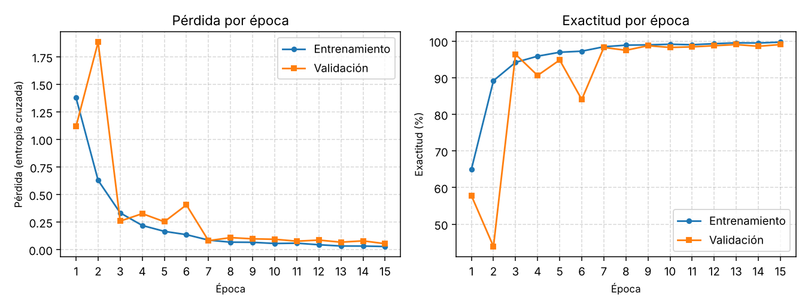
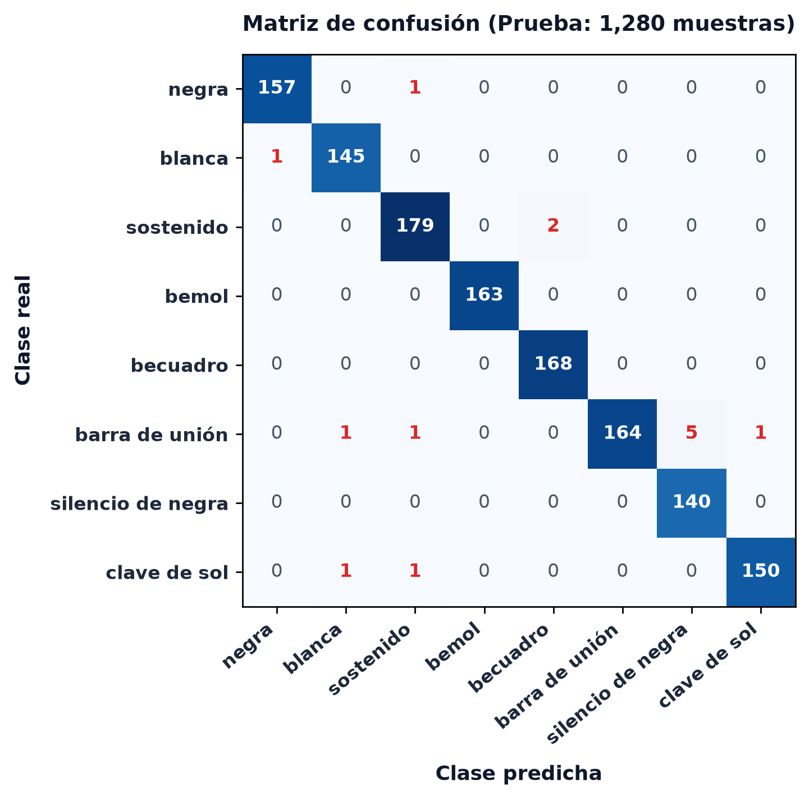
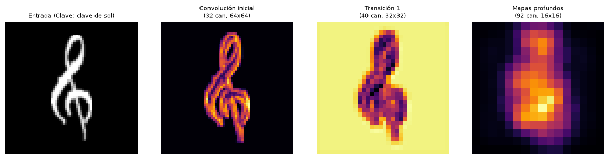

# Reconocimiento de figuras musicales mediante redes convolucionales densas

Este repositorio documenta el diseño, formulación matemática, recolección de datos, evaluación cuantitativa y despliegue interactivo de un sistema de visión artificial orientado a clasificar símbolos de la notación musical occidental dibujados a mano. El sistema emplea la arquitectura convolucional densa (*DenseNet*) en PyTorch y una interfaz web desacoplada en Flask.

## Información del proyecto

| Campo | Detalle |
| :--- | :--- |
| **Proyecto** | Clasificador de símbolos musicales usando redes neuronales densas |
| **Curso** | Computación Gráfica (CC431A) |
| **Institución** | Universidad Nacional de Ingeniería — Facultad de Ciencias |
| **Integrantes** | • Anngie Salazar Álvarez (Código: 20162195F) • Gabriel Arturo Rincón Miranda (Código: 20231285E) • Erick Daniel Ortega Morán (Código: 20210209H) |
| **Demostración pública** | [https://clasificador-de-simbolos-musicales.onrender.com](https://clasificador-de-simbolos-musicales.onrender.com) |

> [!NOTE]  
> Si el servicio ha permanecido inactivo durante más de 15 minutos, la instancia entra en modo de suspensión automática en el plan gratuito de Render; la primera solicitud puede tardar entre 30 y 50 segundos mientras se reactiva la máquina virtual. Asimismo, el análisis por la red neuronal puede requerir unos instantes adicionales debido a la cuota limitada de procesamiento asignada por el host (0.1 CPU, 512 MB RAM).

---

## Fundamentación matemática y teórica de la red neuronal

El análisis óptico de grafías musicales afronta desafíos particulares derivados de la presencia de trazos delgados (plicas, barras y alteraciones), variaciones locales de grosor y contornos geométricos afines entre distintas categorías. Para abordar estas restricciones con un número reducido de parámetros entrenables, se implementa el principio de conectividad densa (*DenseNet*).

### Conectividad densa y reutilización de características

En una red convolucional secuencial clásica, la capa $l$ recibe únicamente la salida de la capa anterior $x_l = H_l(x_{l-1})$. En contraste, en una red densa cada capa se conecta directamente con todas las capas subsiguientes dentro del mismo bloque mediante la concatenación de tensores a lo largo del eje de canales:

$$x_l = H_l([x_0, x_1, \dots, x_{l-1}])$$

donde:
- $[x_0, x_1, \dots, x_{l-1}] \in \mathbb{R}^{H \times W \times c_{\text{in}}}$ denota el tensor resultante de concatenar los mapas producidos por todas las etapas precedentes.
- $H_l(\cdot)$ representa una transformación no lineal compuesta conformada por la secuencia: **Normalización por lotes (BatchNorm) $\to$ Activación no lineal (ReLU) $\to$ Convolución bidimensional ($3 \times 3$)**:

$$H_l(\mathbf{z}) = \mathbf{W}_l * \sigma(\text{BN}(\mathbf{z}))$$

con pesos $\mathbf{W}_l \in \mathbb{R}^{3 \times 3 \times c_{\text{in}} \times k}$, activación no lineal $\sigma(u) = \max(0, u)$ y relleno (*padding*) de 1 para preservar la resolución espacial $(H, W)$.
- **Tasa de crecimiento ($k=16$):** Cada función $H_l$ añade $k$ nuevos canales al estado global. Si el bloque inicia con $k_0$ canales, la capa $l$ recibe $k_0 + (l - 1)k$ canales de entrada. Esta propiedad permite que los filtros primitivos (orientación de trazos, esquinas) permanezcan accesibles en las capas más profundas sin desvanecimiento de gradiente.

### Control de dimensionalidad y capas de transición

Para regular la acumulación de canales y reducir gradualmente el tamaño espacial entre bloques contiguos, se intercalan capas de transición. Cada capa de transición aplica:
1. Convolución puntual $1 \times 1$ con factor de compresión $\theta = 0.5$, reduciendo a la mitad los canales acumulados:

$$c_{\text{out}} = \lfloor \theta \cdot c_{\text{in}} \rfloor$$

2. Submuestreo espacial de promedio (*Average Pooling*) $2 \times 2$ con paso (*stride*) de 2, reduciendo el ancho y alto del mapa a la mitad.

### Agrupamiento promedio global y clasificación probabilística

Al concluir el último bloque denso, la red dispone de una representación de 92 canales de tamaño $16 \times 16$. En lugar de aplanar la matriz hacia capas totalmente conectadas (lo que incrementaría drásticamente los parámetros y el riesgo de sobreajuste), se aplica un agrupamiento promedio global (*Global Average Pooling*, GAP):

$$\bar{z}_c = \frac{1}{H \cdot W} \sum_{i=1}^H \sum_{j=1}^W f_c(i, j), \quad c \in \{1, \dots, 92\}$$

Este operador reduce cada canal a una magnitud escalar invariante a traslaciones espaciales locales. La proyección final hacia el espacio de 8 clases se realiza mediante una transformación afín y la función Softmax:

$$\hat{p}_c = \frac{\exp(\mathbf{w}_c^T \bar{\mathbf{z}} + b_c)}{\sum_{j=1}^8 \exp(\mathbf{w}_j^T \bar{\mathbf{z}} + b_j)}$$

La optimización de parámetros se rige por la función de pérdida de entropía cruzada multiclase:

$$\mathcal{L}_{\text{CE}} = - \sum_{c=1}^8 y_c \log(\hat{p}_c)$$

donde $y_c \in \{0, 1\}$ indica la pertenencia real a la clase $c$.

---

## Metodología y procedimiento experimental

El flujo de trabajo prioriza el procesamiento digital de imágenes y la formulación del modelo:

1. **Recolección de datos propios en lienzo (`recolector.py`):**  
   Para cerrar la brecha entre las bases públicas escaneadas y la interacción en pantalla táctil o ratón, se recolectaron **1,200 dibujos manuales** (150 por categoría) trazados directamente sobre un lienzo de 220×220 px con trazo de 12 px (idéntico al entorno de prueba final).
2. **Selección del conjunto de referencia:**  
   Se extrajeron 650 muestras complementarias por categoría del repositorio internacional Rebelo (`db1` y `db2`), consolidando un conjunto equilibrado de **800 instancias por clase (6,400 muestras en total)**.
3. **Estandarización y normalización morfológica:**  
   Cada imagen se binarizó con inversión de luminancia (fondo 0, trazo 1), se centró geométricamente calculando su centro de masa con un margen perimetral del 15% y se remuestreó mediante interpolación bilineal a una matriz fija de $64 \times 64$ puntos flotantes en el intervalo $[0.0, 1.0]$.
4. **Partición estratificada desacoplada:**
   - Conjunto de entrenamiento: 4,480 muestras (70%).
   - Conjunto de validación: 640 muestras (10%).
   - Conjunto de prueba ciego: 1,280 muestras (20%, 160 por clase).
5. **Optimización:**  
   Entrenamiento durante 15 épocas con optimizador Adam ($\eta_0 = 0.001$, $\beta_1 = 0.9$, $\beta_2 = 0.999$), tamaño de lote de 32 y reducción adaptativa de tasa ante estancamientos en validación (`ReduceLROnPlateau`).

---

## Manual de especificaciones interno del sistema

A continuación se detalla la estructura interna de clases, atributos principales y métodos que rigen el funcionamiento del modelo:

### 1. `ConvBlock` (`src/model.py`)
Unidad básica de transformación compuesta $H_l$:
- **Atributos:**
  - `bn` (`nn.BatchNorm2d`): Normalización de media y varianza sobre los canales de entrada.
  - `relu` (`nn.ReLU`): Activación no lineal inplace.
  - `conv` (`nn.Conv2d`): Filtro convolucional bidimensional $3 \times 3$, relleno (*padding*) de 1, sin término de sesgo (*bias*).
- **Métodos:**
  - `forward(x)`: Evalúa $H_l(x) = \text{conv}(\text{relu}(\text{bn}(x)))$ y concatena el resultado con el tensor de entrada mediante `torch.cat([x, out], dim=1)`.

### 2. `DenseBlock` (`src/model.py`)
Encadena múltiples transformaciones compuestas consecutivas:
- **Atributos:**
  - `layers` (`nn.ModuleList`): Lista secuencial de instancias de `ConvBlock`.
  - `out_channels` (`int`): Conteo final de canales acumulados tras aplicar las capas del bloque ($c_{\text{in}} + L \cdot k$).
- **Métodos:**
  - `forward(x)`: Propaga el tensor a través de cada `ConvBlock`, expandiendo el número de canales en cada paso.

### 3. `TransitionLayer` (`src/model.py`)
Módulo de compresión entre bloques densos adyacentes:
- **Atributos:**
  - `bn`, `relu`: Normalización y activación.
  - `conv` (`nn.Conv2d`): Convolución puntual $1 \times 1$ que reduce canales según el factor $\theta = 0.5$.
  - `pool` (`nn.AvgPool2d`): Reductor espacial con ventana $2 \times 2$ y paso (*stride*) de 2.
- **Métodos:**
  - `forward(x)`: Aplica BN $\to$ ReLU $\to$ Conv 1x1 $\to$ AvgPool 2x2.

### 4. `DenseNetMusical` (`src/model.py`)
Red convolucional completa para clasificación de símbolos musicales:
- **Atributos:**
  - `init_conv` (`nn.Sequential`): Convolución $3 \times 3$ inicial de 32 canales que preserva resolución $64 \times 64$.
  - `features` (`nn.ModuleList`): Secuencia de 3 bloques densos (3 capas cada uno, $k=16$) y 2 capas de transición.
  - `gap` (`nn.AdaptiveAvgPool2d`): Operador de agrupamiento espacial promedio global colapsando a $1 \times 1$.
  - `classifier` (`nn.Linear`): Proyección lineal de 92 canales hacia las 8 clases de salida.
- **Métodos:**
  - `extract_features(x)`: Propaga la entrada hasta la salida del último bloque denso ($92 \times 16 \times 16$).
  - `forward(x)`: Extrae características, aplica GAP, aplana la dimensión espacial y computa los logits lineales.
  - `get_intermediate_activations(x)`: Extrae y retorna diccionarios con mapas de activación en 3 etapas clave (`capa_inicial`, `transicion_1` y `mapas_profundos`).
  - `compute_cam(x, class_idx)`: Genera el mapa de activación de clases proyectando los pesos del clasificador sobre los mapas finales.

### 5. `MusicalSymbolPredictor` (`src/predict.py`)
Motor desacoplado de preprocesamiento e inferencia:
- **Atributos:**
  - `model` (`DenseNetMusical`): Instancia del modelo cargada en modo evaluación (`eval`).
  - `device` (`torch.device`): Dispositivo de cálculo (CPU).
  - `classes_info` (`list[dict]`): Metadatos y glifos de las 8 categorías.
- **Métodos:**
  - `preprocess_base64(image_str)` / `preprocess_pil(img)`: Decodifica datos visuales, binariza, calcula centro de masa y construye tensor normalizado $1 \times 1 \times 64 \times 64$.
  - `predict(image_data, top_k, return_layers)`: Ejecuta inferencia atómica sin gradientes, calcula distribución Softmax, rankea el top K y serializa mapas de activación en base64.

### 6. `SessionSpace` y `SessionRegistry` (`web/app.py`)
Controlador de aislamiento concurrente por cliente:
- **Atributos:**
  - `session_id` (`str`): Identificador único de sesión de la pestaña o ventana.
  - `lock` (`threading.RLock`): Cerrojo de sincronización exclusivo para el estado de la sesión.
  - `stats` (`dict`): Registro métrico personal (`correctas`, `incorrectas`, `invalidas`, `total`, `tasa_acierto`).
  - `historial` (`list`): Registro cronológico de consultas evaluadas en dicha sesión.
- **Métodos:**
  - `registrar_consulta(prediccion)`: Registra métricas de consulta para la sesión.
  - `registrar_feedback(tipo)`: Incrementa contadores individuales y recalcula la tasa de acierto de forma atómica.
  - `reiniciar()`: Restablece todos los contadores de la sesión a cero.

---

## Lógica y métodos principales de la red neuronal

La solución expone módulos desacoplados en Python para la ingesta de imágenes, extracción de características, propagación densa y evaluación probabilística:

### 1. Objeto `MusicalSymbolPredictor` (`src.predict`)
Fachada de alto nivel para consumo de inferencia en producción o entornos de prueba:

- **`__init__(model_path: Optional[str] = None, config_path: Optional[str] = None, device: Optional[torch.device] = None)`**:
  - *Entrada:* Rutas opcionales al archivo de pesos serializado (`.pth`) y catálogo de clases (`.json`), y dispositivo de cómputo.
  - *Comportamiento:* Carga los hiperparámetros de la red, inicializa `DenseNetMusical` en modo evaluativo (`eval()`), transfiere los tensores al dispositivo correspondiente y construye los índices de consulta de clases.

- **`predict(preprocessed_64x64: np.ndarray, top_k: int = 4, generate_cam: bool = False, return_layers: bool = False) -> Dict[str, Any]`**:
  - *Entrada:*
    - `preprocessed_64x64`: Arreglo bidimensional `np.ndarray` de dimensiones $(64, 64)$ y tipo `uint8` $[0, 255]$ (trazo blanco sobre fondo negro).
    - `top_k`: Cantidad de hipótesis más probables a ordenar (por defecto: 4).
    - `generate_cam`: Booleano que activa el cómputo de saliencia Class Activation Map.
    - `return_layers`: Booleano que activa la extracción y codificación base64 de los mapas de activación intermedios.
  - *Salida (`dict`):*
    - `prediction`: Diccionario con la hipótesis ganadora (`id`, `name`, `symbol`, `category`, `probability`, `percentage`).
    - `top_k`: Lista de diccionarios con las $k$ alternativas ordenadas de mayor a menor probabilidad.
    - `all_probabilities`: Lista de 8 valores flotantes que suman $1.0$.
    - `capas_intermedias` (opcional): Lista con metadatos y proyecciones base64 de las 3 etapas convolucionales clave.
    - `cam_base64` (opcional): Mapa de saliencia en formato PNG codificado en base64.
  - *Comportamiento abstracto:* Escala los valores al dominio continuo $[0.0, 1.0]$, conforma un tensor de cuatro dimensiones $(1, 1, 64, 64)$, ejecuta la propagación sin seguimiento de gradientes (`torch.no_grad()`) y aplica la función de activación Softmax sobre los logits resultantes.

- **`preprocess_image_file(file_path: str) -> np.ndarray`**:
  - *Entrada:* Ruta absoluta o relativa a un archivo de imagen en disco (`.png`, `.jpg`, `.bmp`).
  - *Salida:* Matriz `np.ndarray` de $(64, 64)$ en `uint8`.

- **`preprocess_pil(pil_image: Image.Image) -> np.ndarray`**:
  - *Entrada:* Objeto de imagen en memoria compatible con Pillow.
  - *Salida:* Matriz normalizada `np.ndarray` $(64, 64)$ en `uint8`.

- **`preprocess_base64(b64_string: str) -> np.ndarray`**:
  - *Entrada:* Cadena en base64 con o sin prefijo data-URI (`data:image/png;base64,...`).
  - *Salida:* Matriz normalizada `np.ndarray` $(64, 64)$ en `uint8`.

---

### 2. Objeto `DenseNetMusical` (`src.model`)
Módulo central de red neuronal convolucional basado en PyTorch:

- **`forward(x: torch.Tensor) -> torch.Tensor`**:
  - *Entrada:* Tensor de cuatro dimensiones $(B, 1, 64, 64)$ con tipo `torch.float32` en el intervalo $[0.0, 1.0]$.
  - *Salida:* Tensor de logits sin normalizar $(B, 8)$ con tipo `torch.float32`.
  - *Comportamiento abstracto:* Propaga el lote a través de la convolución inicial (32 canales), los 3 bloques densos con conexiones de concatenación, las 2 capas de transición con compresión $\theta=0.5$, el agrupamiento espacial global `AdaptiveAvgPool2d((1, 1))` y la proyección lineal final.

- **`extract_features(x: torch.Tensor) -> torch.Tensor`**:
  - *Entrada:* Tensor $(B, 1, 64, 64)$.
  - *Salida:* Tensor de características profundas $(B, 92, 16, 16)$ previo a la reducción dimensional de GAP.

- **`get_intermediate_activations(x: torch.Tensor) -> Dict[str, torch.Tensor]`**:
  - *Entrada:* Tensor $(B, 1, 64, 64)$.
  - *Salida:* Diccionario con tres tensores que capturan la evolución de abstracción:
    - `"capa_inicial"`: $(B, 32, 64, 64)$.
    - `"transicion_1"`: $(B, 40, 32, 32)$.
    - `"mapas_profundos"`: $(B, 92, 16, 16)$.

- **`compute_cam(x: torch.Tensor, class_idx: Optional[int] = None) -> Tuple[np.ndarray, np.ndarray, int]`**:
  - *Entrada:* Tensor de entrada $(1, 1, 64, 64)$ e índice entero opcional de la clase objetivo.
  - *Salida:* Mapa de activación de clase ponderado normalizado en $[0.0, 1.0]$ como `np.ndarray` de $(64, 64)$, vector de probabilidades Softmax e índice de clase evaluado.

---

### 3. Canalización de datos y colecciones (`src.dataset`)
Componentes de carga, particionamiento y curación del conjunto de entrenamiento y prueba:

- **`create_dataloaders(data_file_path: Optional[str] = None, batch_size: int = 32, test_split: float = 0.2, val_split: float = 0.1, seed: int = 42) -> Tuple[DataLoader, DataLoader, DataLoader, Dict[str, int]]`**:
  - *Entrada:* Ruta opcional al archivo empaquetado `data_musical.npz`, tamaño de lote, proporciones de partición y semilla pseudoaleatoria.
  - *Salida:* Tupla conformada por `train_loader`, `val_loader`, `test_loader` e historial de conteos por partición.
  - *Comportamiento abstracto:* Carga las matrices $X$ e $y$, instancia `MusicalSymbolsDataset` y genera una partición determinista reproducible que garantiza el 70% para optimización, 10% para validación temprana y 20% para evaluación ciega independiente.

- **`load_classes_metadata(config_path: Optional[str] = None) -> List[Dict[str, Any]]`**:
  - *Entrada:* Ruta opcional al archivo JSON de configuración.
  - *Salida:* Lista ordenada de las 8 especificaciones de clase (`id`, `name`, `key`, `symbol`, `category`, `description`).

- **`MusicalSymbolsDataset(images: np.ndarray, labels: np.ndarray, transform: Optional[Callable] = None)`**:
  - *Entrada:* Matrices NumPy de imágenes $(N, 64, 64)$ en `uint8` y etiquetas $(N,)$ en `int64`.
  - *Salida de `__getitem__(idx)`:* Tupla `(img_tensor, label_tensor)` donde `img_tensor` tiene dimensión $(1, 64, 64)$ en flotante y `label_tensor` es un escalar `torch.long`.

---

## Evaluación cuantitativa y análisis de métricas

Evaluación realizada sobre las 1,280 muestras del conjunto de prueba independiente en procesador CPU:

| Métrica | Dominio | Definición formal | Interpretación en el contexto |
| :--- | :---: | :--- | :--- |
| Exactitud Top-1 | $[0, 100]\%$ | $\frac{1}{N} \sum_{i=1}^N \mathbb{I}(\hat{y}_{i, 1} = y_i)$ | Coincidencias exactas donde el logit de máxima probabilidad corresponde a la clase real: **98.91%** (1,266 / 1,280). |
| Exactitud Top-2 | $[0, 100]\%$ | $\frac{1}{N} \sum_{i=1}^N \mathbb{I}(y_i \in \{\hat{y}_{i, 1}, \hat{y}_{i, 2}\})$ | Proporción donde la clase real figura en las dos alternativas más probables: **99.69%** (1,276 / 1,280). |
| Precisión | $[0, 100]\%$ | $\frac{TP}{TP + FP}$ | Pureza de las predicciones positivas por categoría. Mínima en silencio de negra (96.55%) y 100.0% en bemol y barra de unión. |
| Exhaustividad (Recall) | $[0, 100]\%$ | $\frac{TP}{TP + FN}$ | Proporción de instancias reales identificadas con éxito. 100.0% en silencio de negra, bemol y becuadro. |
| F1-Score | $[0, 100]\%$ | $2 \cdot \frac{\text{Precisión} \cdot \text{Recall}}{\text{Precisión} + \text{Recall}}$ | Media armónica balanceada entre precisión y exhaustividad: **98.90%**. |
| Latencia media CPU | $[0, \infty)$ ms | $\bar{t} = \frac{1}{M} \sum_{k=1}^M t_{\text{inferencia}, k}$ | Tiempo de propagación hacia adelante por muestra en procesador CPU: **14.57 ms** (P95: 16.01 ms). |
| Rendimiento (Throughput) | $[0, \infty)$ fps | $\text{Throughput} = \frac{1000}{\bar{t}}$ | Capacidad de procesamiento continuo en CPU estándar: **68.6 cuadros/segundo**. |
| Margen de certidumbre | $[0, 100]\%$ | $\Delta P = \bar{P}_{\text{acierto}} - \bar{P}_{\text{error}}$ | Brecha entre la confianza promedio en aciertos (98.15%) y equivocaciones (69.90%): **28.26%**. |

### Métricas detalladas por clase

| Clase | Símbolo | Precisión (%) | Recall (%) | F1-Score (%) | Muestras de prueba |
| :--- | :---: | :---: | :---: | :---: | :---: |
| Figura: negra | 𝅘𝅥 | 99.37 | 99.37 | 99.37 | 158 |
| Figura: blanca | 𝅗𝅥 | 98.64 | 99.32 | 98.98 | 146 |
| Armadura: sostenido | ♯ | 98.35 | 98.90 | 98.62 | 181 |
| Armadura: bemol | ♭ | 100.00 | 100.00 | 100.00 | 163 |
| Armadura: becuadro | ♮ | 98.82 | 100.00 | 99.41 | 168 |
| Compuesto: barra de unión | ♫ | 100.00 | 95.35 | 97.62 | 172 |
| Silencio: silencio de negra | 𝄽 | 96.55 | 100.00 | 98.25 | 140 |
| Clave: clave de sol | 𝄞 | 99.34 | 98.68 | 99.01 | 152 |

### Impacto de los datos propios

| Métrica | Solo base pública (8 épocas) | Base pública + dibujos propios (15 épocas) |
| :--- | :---: | :---: |
| Exactitud Top-1 | 96.17% | **98.91%** |
| Exactitud Top-2 | 98.83% | **99.69%** |
| F1 ponderado | 96.19% | **98.90%** |
| Errores totales en prueba | 49 / 1,280 | **14 / 1,280** |
| Precisión mínima por clase | 83.58% (becuadro) | **96.55%** (silencio de negra) |

### Gráficas experimentales

---

## Observaciones sobre casos particulares

1. **Corcheas unidas por barra / Doble negra (`beams`):**  
   - *Comportamiento previo:* En la base de datos pública de partida, esta categoría únicamente contemplaba trazos de barras horizontales o inclinadas aisladas (cortadas del pentagrama), desprovistas de plicas y cabezas de nota. El modelo base reconocía con 100% de acierto dibujos de 2 a 3 líneas aisladas, pero fracasaba por completo al intentar clasificar figuras completas dibujadas por los usuarios.
   - *Curación y adaptación:* De la amplia gama de agrupaciones polifónicas compuestas existentes en notación musical, se eligió para la demostración el caso más representativo y frecuente: **corcheas unidas por barra** (denominadas habitualmente *doble negra* o *notas unidas por beam con plicas*). Se complementó el conjunto de entrenamiento con 150 dibujos manuales por integrante de este símbolo completo trazado en el lienzo.
   - *Resultado actual:* La red reconoce con éxito tanto las barras/líneas solas como la figura completa de corcheas unidas (doble negra). Su exhaustividad es del 95.35% (164 de 172 aciertos en prueba), siendo ligeramente menor a figuras más elementales debido a la mayor complejidad geométrica de unir tres trazos (dos plicas y una barra) y a que 5 muestras se confundieron con el silencio de negra por compartir trazos diagonales inclinados.

2. **Silencio de negra:**  
   - *Varianza en la base original:* Las muestras preexistentes presentaban una marcada dispersión tipográfica y caligráfica (zigzags angulares de estilo antiguo, curvas manuscritas y variaciones extremas de inclinación), lo que hacía que el reconocimiento de trazos directos en pantalla resultara errático y complejo (alcanzando solo 83.58% de recall en el modelo entrenado únicamente con datos públicos).
   - *Estabilización con datos propios:* La inclusión de 150 muestras manuales adicionales capturadas en el lienzo interactivo enseñó al modelo la cinemática de trazado real de los usuarios, reduciendo drásticamente las fallas y elevando la exhaustividad en el conjunto independiente de prueba al **100.0% (140 de 140 aciertos)**.

---

## Conclusiones

1. **Valor de los datos en el dominio de inferencia:** Complementar la base pública con 1,200 dibujos capturados en el mismo lienzo redujo los errores de 49 a 14, mitigando la confusión entre alteraciones y estabilizando el silencio de negra.
2. **Eficiencia arquitectónica de DenseNet:** La reutilización de características mediante concatenación permite alcanzar 98.91% de exactitud con únicamente 80,520 parámetros, operando en CPU sin requerir tarjetas aceleradoras GPU.
3. **Calibración y robustez:** El margen de certidumbre de 28.26% constata que el clasificador no produce sobreconfianza espuria en presencia de trazos ambiguos.
4. **Aislamiento concurrente:** El diseño basado en `SessionSpace` garantiza independencia total entre múltiples evaluadores que interactúan simultáneamente con la plataforma web.

---

## Recursos y referencias bibliográficas

1. **Base de datos de símbolos musicales:**
   - Rebelo, A., Capela, G., & Cardoso, J. S. (2010). *Optical recognition of music symbols: A comparative study*. International Journal on Document Analysis and Recognition (IJDAR), 13(1), 19-31.
   - Pacha, A. (2018). *OMR-Datasets: A collection of datasets used for Optical Music Recognition*. Repositorio: https://github.com/apacha/OMR-Datasets (Licencia CC BY-SA 4.0).
2. **Arquitectura DenseNet:**
   - Huang, G., Liu, Z., Van Der Maaten, L., & Weinberger, K. Q. (2017). *Densely connected convolutional networks*. CVPR, pp. 4700-4708.
3. **Material conceptual y de referencia:**
   - Presentaciones teóricas del curso (`teoria/`): *Principios de Arquitecturas Convolucionales: DenseNets* y *Redes Convolucionales para Clasificación de Imágenes*.
   - Cuadernos de estudio (`jupyter referencias/`): *Clasificación de Imágenes* y *Notebook Resnets, Global Average Pooling y Class Activation Maps*.
   - Prototipo base de captura sobre lienzo (`letras_uni/`).
